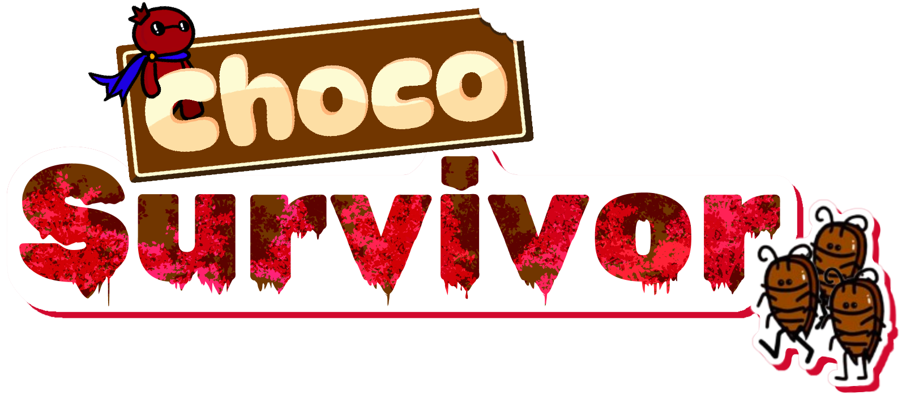

<p align="center">
  
</p>

# Choco Survivor

A top-down wave-survival / tower-defense game written in **C** with DigiPen's
[CProcessing](SOURCE/Extern/CProcessing) framework. Defend the chocolate tower
from hordes of *ChocoRoaches*: shoot, dash, place allies and barricades, and
stack buffs to survive three waves and a boss.

Built by **Team Choco Latte** in 2024 for *CSD1401 Software Engineering Project 1*
at DigiPen Institute of Technology Singapore.

**[Download the Windows build](https://github.com/zonghan822/ChocolateSurvivor/releases/latest)** · [10-second trailer](DOCUMENTS/Choco_Latte_10sec_Choco_Survivor.mp4) · [Pitch deck](DOCUMENTS/Choco_Latte_Pitch.pptx)

## Features

- **A\* pathfinding:** enemies and the boss each navigate their own grid around obstacles and player-placed barricades
- **Placeables:** allied sentry NPCs and barricades that you can level up
- **Buff system:** 10 buffs, including smart gun, freezing shots and reflect damage
- **Boss fight**, camera shake, damage-invulnerability flicker, and audio via FMOD
- **Custom UI widgets** (buttons, sliders, panels, progress bars) built from scratch in C

## My contributions (Law Zong Han)

- A\* pathfinding (`astar.c`) and enemy AI and spawning (`enemy.c`, with Dalton Koh)
- Buff system (`buff.c`, with Dalton Koh)
- Projectile system (`projectile.c`, with Fadzly)
- Level and wave logic (`level.c`, `level1.c`, shared), utilities (`utils.c`) and the credits menu (`creditsmenu.c`)

## Controls

| Input | Action |
| --- | --- |
| `W` `A` `S` `D` | Move |
| `Space` | Dash |
| Mouse / hold left button | Aim / shoot |
| `V` | Place ally |
| `B` | Place barricade |
| Right mouse button | Cancel placement preview |
| `1` `2` `3` | Activate buff |
| `Esc` | Pause |

<details>
<summary>Cheats and debug keys</summary>

| Key | Effect |
| --- | --- |
| `F1`–`F10` | Apply buff: Attack Up, Attack Speed Up, Health Up, Ally Level Up, Barrier Level Up, Health Recover, Smart Gun, Freezing Shots, Fast Shots, Reflect Damage |
| `F11` / `F12` | Show enemy / boss pathfinding grid |
| `Insert` | Show obstacles |
| `Delete` | Show hitboxes |
| `=` | Skip to next wave (after the wave delay) |

</details>

## Building from source

Requirements: Windows and Visual Studio 2022 (MSVC v143).

1. Open `SOURCE/Choco_Survivor.sln`.
2. Select the **x64** platform (Debug or Release).
3. Build and run. A post-build step copies `Assets/` and the CProcessing/FMOD DLLs into `SOURCE/bin/<Config>-x64/`.

The window is fixed at 1600×900.

## Project layout

```
SOURCE/
  src/       game code (~6k lines of C)
  Assets/    sprites, fonts, sounds, music
  Extern/    CProcessing headers and libraries
DOCUMENTS/   pitch deck, final presentation, trailer, team photo
```

See [SOURCE/README.md](SOURCE/README.md) for the team's coding conventions.

## Team

- **Law Zong Han**
- **Muhammad Nur Fadzly Bin Zulkifli**
- **Dalton Koh**

## Credits

- Music jingles, interface sounds and UI Pack – Pixel Adventure by [Kenney](https://kenney.nl)
- Music from the Not Jam Music Pack by Not Jam
- Fonts: Oxanium, Pixelify Sans and Tiny5 (SIL Open Font License)
- Audio powered by FMOD Studio by Firelight Technologies Pty Ltd.
- CProcessing framework by DigiPen Institute of Technology

---

All content © 2024 DigiPen Institute of Technology Singapore. All rights reserved.
Shared here as a student portfolio piece.
